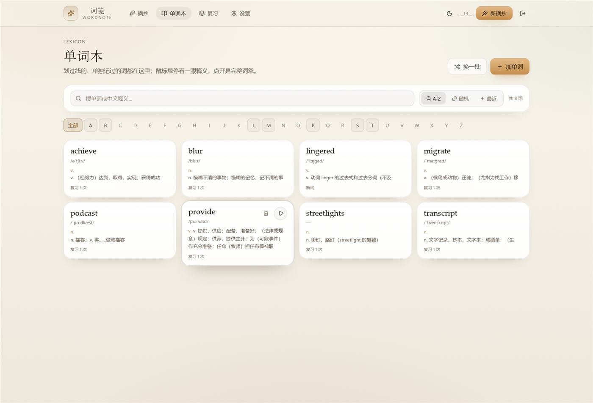
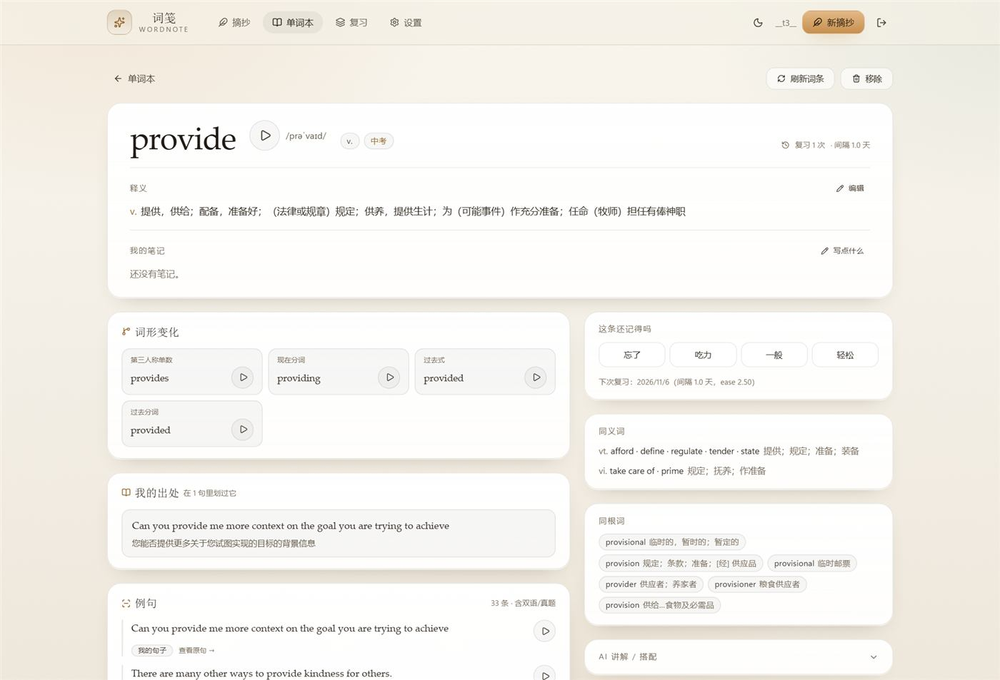
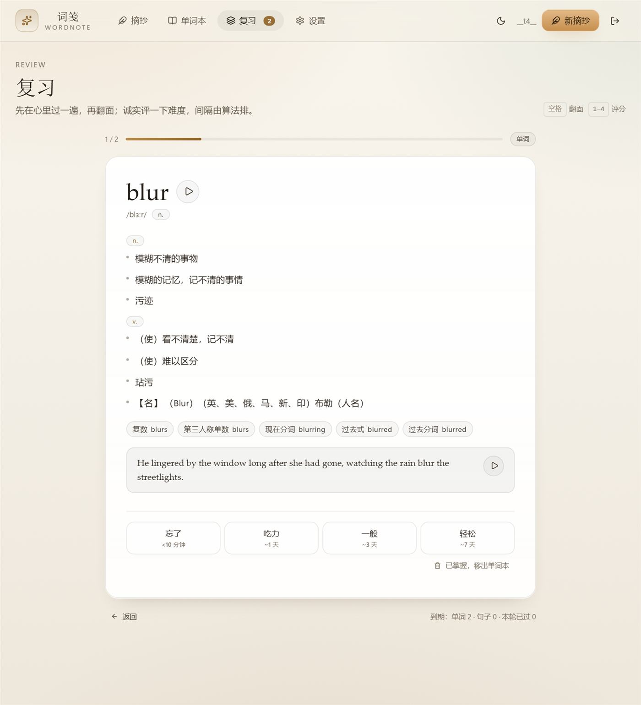

# 词笺 Wordnote

**把看到的好英文留下来，划线、翻译、吃透、复习。**

一个跑在自己电脑 / 家庭内网里的私人英语语料库：在 Slack、播客、文章里遇到想记的句子，整句贴进来，
点一下单词就划线；系统自动给出**对照译文**，并为每个划线词建**带音标、词形变化、双语例句**的词条；
之后按 SM-2 间隔复习，发音用本地部署的 **Supertonic 3**。

| | |
|---|---|
| 前端 | React 19 + Vite + TypeScript + Tailwind v4，深/浅双主题 |
| 后端 | FastAPI + SQLite，单进程同时托管 API 与前端静态资源 |
| 发音 | Supertonic 3（audiocpp / GGUF），本地合成，44.1 kHz，10 个音色 |
| 翻译 / 词条 | MyMemory + 有道词典公开接口 + dictionaryapi.dev + 本地 ECDICT，全部免费免 Key |
| 数据 | 单文件 `data/wordnote.db`，可整库拷走迁移；另支持导出 JSON / SQLite / 离线包 |


<p align="center">
  
  
</p>
<p align="center">
  
  
  
</p>

<sub>上面是浅色「暖纸」主题；深色「墨」的效果见 <a href="docs/shots/dashboard-dark.jpg">dashboard-dark.jpg</a>。</sub>

---

## 目录

- [功能](#功能)
- [用户指南](#用户指南)
  - [快速开始](#快速开始)
  - [日常用法](#日常用法)
  - [离线能做什么](#离线能做什么)
  - [常见问题](#常见问题)
- [开发者指南](#开发者指南)
  - [架构](#架构)
  - [技术栈与依赖](#技术栈与依赖)
  - [部署方案](#部署方案)
  - [配置项](#配置项)
  - [启动方式](#启动方式)
  - [目录结构](#目录结构)
  - [数据模型](#数据模型)
  - [API 一览](#api-一览)
  - [测试](#测试)
  - [已知限制与安全边界](#已知限制与安全边界)
- [致谢与许可](#致谢与许可)

---

## 功能

| 能力 | 说明 |
|---|---|
| 整句摘抄 + 划线 | 句子里的单词点一下即划线（茶金色下划线），一个句子可划多个词；划线位置按**字符偏移**存库，改文本不会错位 |
| 对照翻译 | 保存时自动翻译；可重译、可手动改写；译文永久缓存 |
| 划词详解 | 每个划线词自动建词条：英美音标、词性、中文释义（按词性分组、编号条目排版）、词形变化、双语例句、真题例句、同义词、词组、同根词、词源 |
| 单词本 | A-Z 索引（带字母计数）、随机翻牌、最近；悬停看音标与简义，点开看完整词条 |
| 复习 | SM-2 简化版，句子和单词都进队列；空格翻面、1–4 评分；「已掌握，移出」直接清理 |
| 发音 | Supertonic 3 本地合成；同一文本只合成一次，落盘缓存，离线可用 |
| 删除 / 清理 | 摘抄墙卡片、单词本卡片悬停出垃圾桶；详情页常驻按钮；删词只解除划线，不误伤句子 |
| 离线 | 已摘抄内容全部本地；新词走本地 ECDICT 查中文释义；可导出离线包 |
| 主题 | 深色「墨」/ 浅色「暖纸」，顶部一键切，设置页三态（跟随系统 / 浅色 / 深色） |
| 数据迁移 | `data/wordnote.db` 单文件；导出 JSON / SQLite / 离线 zip（db + 词库 + 全部音频 + 恢复说明） |

---

## 用户指南

### 快速开始

前置：Python 3.11+、Node 20+、pnpm、[uv](https://github.com/astral-sh/uv)（可选，用来建虚拟环境）。

```bash
git clone https://github.com/shishuyao/WordNote.git
cd WordNote

# 1) 后端依赖
uv venv --python 3.12              # 或：python -m venv .venv
uv pip install -r pyproject.toml   # 或：uv pip install fastapi uvicorn httpx

# 2) 构建前端（产物 web/dist 由后端直接托管）
cd web && pnpm install && pnpm build && cd ..

# 3) 启动
cd server && ../.venv/Scripts/python.exe -m uvicorn app.main:app --host 0.0.0.0 --port 8100
# Linux/macOS：../.venv/bin/python -m uvicorn app.main:app --host 0.0.0.0 --port 8100
```

浏览器打开 `http://127.0.0.1:8100`，第一次会要求**设置账号密码**（数据只在本机）。
手机同一 Wi-Fi 打开 `http://<这台电脑的局域网IP>:8100` 即可。

> Windows 用户直接用脚本更省事：
> ```powershell
> powershell -ExecutionPolicy Bypass -File scripts/start-all.ps1          # 启动
> powershell -ExecutionPolicy Bypass -File scripts/status.ps1             # 看状态
> powershell -ExecutionPolicy Bypass -File scripts/install-autostart.ps1  # 登录自启 + 每 5 分钟守护
> ```

### 日常用法

1. **摘一句**：右上「新摘抄」→ 贴英文 → 下方预览里点单词划线 → 保存（自动翻译、自动建词条）。
2. **补划 / 取消**：句子详情页右上「编辑划线」，点词即划，点已划的词可看释义或取消。
3. **单独记词**：单词本右上「加单词」，或「新摘抄 → 单词」标签，先查预览再入库。
4. **复习**：导航「复习」，空格翻面，1–4 评分；`1 忘了` → 1 天，`4 轻松` → 7 天起，之后按 ease 拉长。
5. **删学完的**：卡片悬停出垃圾桶，或详情页删除；复习页底部「已掌握，移出」。删除不可撤销，确认框会拦一道。
6. **备份 / 迁移**：设置 → 数据与迁移 → 导出 JSON / 导出 SQLite / 导出离线包。

### 离线能做什么

断公网（不是断内网）时：已摘抄的句子、译文、词条、例句、单词本、复习、发音**全部照常**。
只有「查没查过的新词例句」「翻新句子」需要联网。

想让断网也能查新词的中文释义，装本地词库（59,137 个高频词 / 约 12 MB）：

```bash
# 首次下载 ECDICT（约 66 MB；中国大陆直连 GitHub raw 常超时，可挂代理）
curl -L -o data/ecdict.csv https://raw.githubusercontent.com/skywind3000/ECDICT/master/ecdict.csv
.venv/Scripts/python.exe scripts/import_ecdict.py     # 生成 data/ecdict.db
```

设置页「离线能力」还有三个按钮：补全待查词条、预合成全部发音、导出离线包。
彻底离线可设 `WORDNOTE_OFFLINE=1` 启动，服务不发任何外网请求。

### 常见问题

| 问题 | 处理 |
|---|---|
| 点发音没声音 | 设置 → 英文发音 看「服务在线 / 模型已加载」是否绿色；未配置 Supertonic 时发音不可用，其它功能不受影响 |
| 翻译失败 | MyMemory 免费额度用尽（匿名约 5k 字符/天）；手填译文即可，或设 `MYMEMORY_EMAIL` 提到 ~50k |
| 忘记密码 | 删掉 `data/wordnote.db` 里 `users` 表记录，刷新页面重新初始化（摘抄数据不受影响） |
| 换电脑 | 拷 `data/` 整个目录（含 `wordnote.db`、`audio/`、`secret.key`），或导出离线包 |
| 手机能开吗 | 同一局域网即可；移动端有底部导航，触屏上播放/删除按钮常显 |
| 数据在哪 | `data/wordnote.db`（SQLite）、`data/audio/*.wav`（发音缓存）、`data/ecdict.db`（离线词库） |

---

## 开发者指南

### 架构

```
浏览器 (React SPA)
   │  HttpOnly Cookie 会话（scrypt 口令 + HMAC 签名）
   ▼
FastAPI (0.0.0.0:8100)  ── 同时托管 web/dist 静态资源与 SPA 路由回退
   ├─ SQLite  data/wordnote.db      （WAL，单文件，可整库迁移）
   ├─ 词条服务  → 有道 jsonapi → ECDICT(本地) → dictionaryapi.dev
   ├─ 翻译服务  → MyMemory（结果入 translate_cache，永不重复请求）
   ├─ 发音服务  → Supertonic 3 audiocpp  127.0.0.1:8090（HTTP，串行 1 路）
   └─ 音频缓存  data/audio/<sha1(voice|text)>.wav
```

要点：

- **单进程**：后端同时提供 API 与前端静态文件，部署面最小，不需要 Nginx。
- **鉴权**：单账号，首启设置密码；`scrypt` 哈希 + HMAC 签名 Cookie（30 天，HttpOnly，SameSite=Lax），写请求校验 Origin。
- **发音串行**：audiocpp 的 CPU 后端并发会触发 `GGML_ASSERT` 崩溃，所以 TTS 请求在后端**串行到 1 路**，并带三级兜底（服务 → 自动重启重试 → CLI）。
- **数据落盘优先**：句子译文、词条快照、例句、音频都在本地；断网只影响"新内容"。

### 技术栈与依赖

| 层 | 选型 | 说明 |
|---|---|---|
| 后端 | Python 3.11+ / FastAPI / uvicorn / httpx | 依赖仅三项（见 `pyproject.toml`），无 ORM，SQLite 走标准库 |
| 前端 | Node 20+ / pnpm / React 19 / Vite 8 / TypeScript / Tailwind v4 / framer-motion / lucide-react | 主题用 CSS 变量（`--wn-*`），Tailwind token 全部映射到变量 |
| 数据库 | SQLite（WAL） | `data/wordnote.db`，schema 版本记在 `PRAGMA user_version`，启动自动迁移 |
| 发音 | Supertonic 3（audiocpp，GGUF q8_0） | **可选**。本地 HTTP 服务，端口 8090；未部署时发音功能降级 |
| 离线词库 | ECDICT（skywind3000，MIT） | **可选**。`scripts/import_ecdict.py` 从 66 MB csv 筛出 59k 高频词 → 12 MB SQLite |
| 翻译 | MyMemory 公共接口 | 免费免 Key；匿名约 5k 字符/天，填 `MYMEMORY_EMAIL` 可提高 |
| 词条 | 有道 `dict.youdao.com/jsonapi` | 非官方公开接口（无需注册，但可能改版/限流）；已做结构容错 + 落库快照 |
| 词条兜底 | dictionaryapi.dev | 纯英文释义，Wiktionary 数据 |
| 开发工具 | Playwright | 仅用于 UI 截图 / E2E（`web/shots.mjs` 等），非运行时依赖 |

### 部署方案

#### 方案 A：Windows 本机常驻（本项目默认）

1. 按「快速开始」装好依赖并 `pnpm build`；
2. 复制 `local.example.json` 到 `data/local.json`，填 Supertonic 的 exe / 模型路径（**不装发音就留空**）；
3. 注册两个计划任务（登录自启 + 每 5 分钟健康守护）：

```powershell
powershell -ExecutionPolicy Bypass -File scripts/install-autostart.ps1
```

| 计划任务 | 触发 | 作用 |
|---|---|---|
| `Wordnote-Start` | 用户登录 | 拉起 Supertonic（若配置）+ Wordnote |
| `Wordnote-Guard` | 登录后常驻 | 每 5 分钟巡检 `/api/health`、8090 端口、watchdog，异常则调 `start-all.ps1` |

日志：`data/logs/start-all.log`、`guard.log`、`wordnote.err.log`（>2 MB 自动截断）。
卸载自启：`scripts/uninstall-autostart.ps1`；停服务：`scripts/stop-all.ps1 [-All]`。

#### 方案 B：Linux / 任意常驻环境（systemd 示例）

```ini
# /etc/systemd/system/wordnote.service
[Unit]
Description=Wordnote
After=network.target

[Service]
WorkingDirectory=/opt/wordnote/server
Environment=WORDNOTE_DATA=/opt/wordnote/data
ExecStart=/opt/wordnote/.venv/bin/python -m uvicorn app.main:app --host 0.0.0.0 --port 8100
Restart=always
RestartSec=3

[Install]
WantedBy=multi-user.target
```

```bash
sudo systemctl daemon-reload && sudo systemctl enable --now wordnote
```

想发到公网：**请在前面加一层 HTTPS 反代**（Caddy/Nginx + 证书）。本项目自身只做内网明文 + 单账号，不适合直接暴露公网。

#### 方案 C：完全离线（不连外网也能用）

1. 按方案 A/B 部署，并导入 ECDICT（`scripts/import_ecdict.py`）；
2. 用 `WORDNOTE_OFFLINE=1` 启动；
3. 关闭系统代理（代码访问本地 TTS 已强制 `NO_PROXY`）。

离线模式的边界：新词能查中文释义/音标/词形，但拿不到例句；新句译文需要手填。

### 配置项

优先级：**环境变量 > `data/local.json` > 代码默认值**。

```json
// local.example.json → 复制为 data/local.json（该文件不进 git）
{
  "speech": {
    "server": "D:\\path\\to\\audiocpp\\app\\audiocpp_server.exe",
    "cli": "D:\\path\\to\\audiocpp\\app\\audiocpp_cli.exe",
    "model_path": "D:\\path\\to\\audiocpp\\models\\Supertonic-3-GGUF",
    "backend": "cpu",
    "threads": 8,
    "watchdog": "D:\\path\\to\\watchdog.py",
    "watchdog_python": "C:\\path\\to\\python.exe"
  }
}
```

| 环境变量 | 默认 | 作用 |
|---|---|---|
| `WORDNOTE_DATA` | `<repo>/data` | 数据目录（db / 音频 / 日志 / 本机配置） |
| `WORDNOTE_DB` | `<data>/wordnote.db` | SQLite 路径 |
| `WORDNOTE_LOCAL_CONFIG` | `<data>/local.json` | 本机部署配置路径 |
| `WORDNOTE_ECDICT` | `<data>/ecdict.db` | 离线词库路径 |
| `WORDNOTE_OFFLINE` | `0` | `1` = 完全离线（不发外网请求） |
| `WORDNOTE_VOICE` | `F5` | 默认音色（F1–F5 / M1–M5） |
| `WORDNOTE_LOOKUP_TTL` | `2592000` | 词典缓存有效期（秒） |
| `WORDNOTE_RETRY_INTERVAL` | `1200` | 待补齐词条的自动重试间隔（秒） |
| `WORDNOTE_PASSWORD` | 空 | 预留：脚本化初始化时使用 |
| `MYMEMORY_EMAIL` | 空 | 填邮箱提高 MyMemory 免费额度 |
| `ST_SERVER` | `http://127.0.0.1:8090` | Supertonic 服务地址 |
| `ST_MODEL_ID` | `supertonic` | 模型 id |
| `ST_MODEL_PATH` / `ST_CLI` / `ST_EXE` | 空 | Supertonic 模型与可执行文件路径（也可写 `local.json`） |
| `ST_BACKEND` / `ST_THREADS` | `cpu` / `8` | audiocpp 后端与线程数 |
| `ST_AUTOSTART` | `1` | 服务挂掉时后端是否自动拉起 audiocpp（`0` 关闭） |
| `WORDNOTE_PORT` | `8100` | 仅 `scripts/start-all.ps1` 使用 |

### 启动方式

| 场景 | 命令 |
|---|---|
| Windows 一键（含守护） | `scripts/start-all.ps1` |
| 手动（生产） | `cd server && python -m uvicorn app.main:app --host 0.0.0.0 --port 8100` |
| 手动（热改后端） | `cd server && python -m uvicorn app.main:app --port 8100 --reload` |
| 前端开发（HMR，5100 端口，`/api` 代理到 8100） | `cd web && pnpm dev` |
| 前端构建 | `cd web && pnpm build`（产物 `web/dist`，后端自动托管） |
| 自检 | `.venv/Scripts/python.exe scripts/smoke_test.py` |

API 文档：`http://127.0.0.1:8100/docs`。

### 目录结构

```
wordnote/
├─ server/
│  ├─ run.py                     本地调试入口（等价于 -m uvicorn）
│  └─ app/
│     ├─ main.py                 应用入口：路由挂载、静态资源、SPA 回退、后台补齐任务
│     ├─ config.py               配置（环境变量 > local.json > 默认）
│     ├─ db.py                   SQLite 连接 / 建表 / 迁移（user_version）
│     ├─ security.py             scrypt 口令 + HMAC Cookie 会话
│     ├─ routers/                auth · sentences · words · review · media(tts) · offline · admin
│     └─ services/               translate · dictlookup · ecdict · tts · words · srs
├─ web/
│  ├─ src/pages/                 Login / Dashboard / SentenceDetail / Compose / Wordbook / WordDetail / Review / Settings
│  ├─ src/components/            Layout · SentenceCard · SentenceText · Senses · ui
│  ├─ src/lib/meaning.ts         释义文本结构化解析（词性分组 + 编号条目）
│  ├─ src/theme.tsx              主题三态 + localStorage + 系统偏好监听
│  └─ shots.mjs / test-theme.mjs Playwright 截图与主题回归脚本
├─ scripts/
│  ├─ start-all.ps1 / stop-all.ps1 / guard.ps1 / status.ps1
│  ├─ install-autostart.ps1 / uninstall-autostart.ps1
│  ├─ import_ecdict.py           构建离线词库
│  └─ smoke_test.py              13 项接口自检（不登录、不碰账号）
├─ docs/                         用户手册 · 截图
├─ local.example.json            本机配置模板（复制到 data/local.json）
└─ data/                         运行态（gitignore）：wordnote.db · audio/ · ecdict.db · logs/
```

### 数据模型

| 表 | 关键字段 | 说明 |
|---|---|---|
| `users` | username, password_hash | 单账号，scrypt 哈希 |
| `sentences` | text, translation, source, note, tags, SM-2 字段 | 摘抄句子 |
| `annotations` | sentence_id, word_id, surface, char_start, char_end | 划线；按字符偏移定位 |
| `words` | headword(unique), 音标, pos, meaning_zh/en, forms, dict_json, lookup_state, SM-2 字段 | 词条；`dict_json` 是完整词典快照 |
| `examples` | word_id, en, zh, source, sentence_id | 词典例句 + 自己划词所在原句 |
| `review_logs` | item_type, item_id, quality, reviewed_at | 复习流水（统计与连续天数） |
| `lookup_cache` / `translate_cache` | q / src, payload / dst | 词典与翻译缓存 |
| `settings` | key, value | 音色等偏好 |

### API 一览

| 分组 | 端点 |
|---|---|
| 鉴权 | `GET /api/auth/me` · `POST /api/auth/{setup,login,logout,password}` |
| 句子 | `GET/POST /api/sentences` · `GET/PATCH/DELETE /api/sentences/{id}` · `POST/DELETE .../annotations` · `POST .../translate` · `POST .../grade` |
| 单词 | `GET/POST /api/words` · `GET/PATCH/DELETE /api/words/{id}` · `POST .../refresh` · `POST .../grade` · `GET /api/words/lookup/any` |
| 复习 | `GET /api/review/queue` · `POST /api/review/grade` · `GET /api/stats` |
| 发音 | `GET /api/tts?text=&voice=` · `GET /api/tts/{voices,status}` · `DELETE /api/tts/cache` |
| 离线 | `GET /api/offline/status` · `POST /api/offline/{retry,prewarm}` |
| 管理与导出 | `GET /api/health` · `GET/PUT /api/settings` · `POST /api/translate` · `GET /api/export/{json,db,bundle}` · `POST /api/import/json` |

### 测试

```bash
# 接口自检（13 项：health / TTS / 静态页 / 离线词库 / 缓存 / 补词条 / 词条快照 / 发音 / 离线包 / ECDICT）
.venv/Scripts/python.exe scripts/smoke_test.py

# UI 截图与主题回归（需要 Playwright：pnpm add -D playwright && npx playwright install chromium）
cd web && node shots.mjs
node test-theme.mjs
```

### 已知限制与安全边界

1. **单账号、无多租户**：设计目标是私人笔记本。
2. **仅适合内网**：HTTP 明文 + 单账号，没有 TLS；要公网请自建 HTTPS 反代。
3. **Supertonic 3 需要单独部署**：本项目只负责调用（HTTP）。CPU 后端并发不安全，已串行化；仍可能偶发崩溃，故障时自动重启并回退 CLI。
4. **有道 jsonapi 非官方接口**：无需注册但可能改版/限流，已做容错与快照；失效时降级到 ECDICT / dictionaryapi.dev。
5. **MyMemory 有配额**：匿名约 5k 字符/天；超额会失败，需手填或配 `MYMEMORY_EMAIL`。
6. **ECDICT 音标是通用音标**（非英美双标），且没有例句。
7. **删除不可撤销**（没有回收站）。
8. **离线模式下新句翻译必须手填**。

---

## 致谢与许可

- 离线词库：[ECDICT](https://github.com/skywind3000/ECDICT)（MIT）
- 发音：[Supertonic](https://github.com/supertone-inc/supertonic) + [audiocpp](https://github.com/audio-cpp)（请遵循上游许可）
- 词条：有道词典公开接口 · [dictionaryapi.dev](https://dictionaryapi.dev)
- 翻译：[MyMemory](https://mymemory.translated.net)
- 前端图标：[lucide](https://lucide.dev)（ISC）

本项目代码暂未附 License 文件；若要复用/分发，请先与作者联系。
